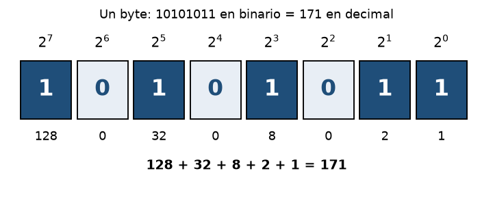

<!-- EVAL01 Desarrollo Web 1 - Tema: Sistema binario y unidad de medida (ATLAS_info.pdf, pp. 188-189). Este comentario no se ve en la vista previa. -->

# Sistema binario y unidad de medida

## Informática y ordenadores

### Introducción

#### El bit

##### La palabra y el byte

###### Resumen del tema

Para codificar información se utiliza el **bit** (de *BInary digiT*), la unidad básica que solo puede asumir el valor «0» o el valor «1». Esta unidad se basa en el sistema numérico posicional binario y en el álgebra booleana, traducidos mediante circuitos lógicos.

Una secuencia de 8 bits se llama **byte** (u «octeto binario») y permite representar *256 valores* distintos. Es un error común creer que ~~un byte tiene 10 bits~~: un byte tiene exactamente 8 bits.

    Párrafo enmarcado: la secuencia mínima de bits, propia de la implementación
    física de un ordenador, se denomina byte y corresponde a 8 bits de longitud.

Para escribir símbolos especiales en Markdown se usa el escape: \*esto no es cursiva\* y \# esto no es un título.

---

## Conceptos clave

El código `1000000` (7 bits) corresponde a la letra «A» en el código `ASCII`, y la misma cadena en minúscula es `1100001`.

Más información en el [curso de Desarrollo Web 1](https://www.eonicasys.com.co/2026-02/DesarrolloWeb1) o directamente en https://www.eonicasys.com.co/2026-02/DesarrolloWeb1

***

> Gottfried Leibniz descubrió el sistema binario en su *Explication de l'Arithmétique Binaire* (1703).
>
>> Leibniz notó que su aritmética coincidía con los hexagramas del antiguo libro chino I Ching.

___

## Listas

Unidades de medida de la información:

- Bit
- Byte (8 bits)

  - Kilobyte (KB)
  - Megabyte (MB)

- Gigabyte (GB)

Pasos para convertir un número decimal a binario:

1. Dividir el número entre 2.
2. Anotar el residuo.

   1. Si el residuo es 1, escribir «1».
   2. Si el residuo es 0, escribir «0».

3. Repetir con el cociente hasta llegar a 0 y leer los residuos al revés.

Tareas del estudio:

- [x] Leer el capítulo de Informática y ordenadores
- [x] Entender qué es un bit
- [ ] Practicar la conversión de decimal a binario
- [ ] Revisar la aritmética binaria de Leibniz

## Tabla de potencias de 2

| Posición | Potencia | Valor decimal | Binario (8 bits) |
|---|---|---|---|
| 0 | 2^0 | 1 | 00000001 |
| 1 | 2^1 | 2 | 00000010 |
| 3 | 2^3 | 8 | 00001000 |
| 4 | 2^4 | 16 | 00010000 |
| 6 | 2^6 | 64 | 01000000 |
| 7 | 2^7 | 128 | 10000000 |

## Código y matemáticas

Función en Python que convierte un decimal a binario con la suma de potencias de 2:

```python
def a_binario(n):
    bits = ""
    while n > 0:
        bits = str(n % 2) + bits
        n = n // 2
    return bits.zfill(8)

print(a_binario(171))  # 10101011
```

El valor de un byte se calcula sumando cada bit multiplicado por su potencia de 2:

```math
\sum_{i=0}^{7} b_i \cdot 2^i = 128 + 32 + 8 + 2 + 1 = 171
```

Una expresión adicional de ejemplo:

```math
(x^2+1)^3
```

## Imagen



## Ayuda

[Abrir archivo ayuda](help.md)
